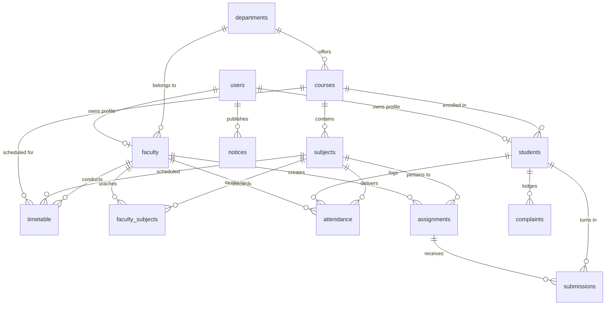

# Smart CampusConnect – Unified Campus Management Portal

> **BCA 5th Semester Major Project 1**  
> Developed by a team of 4 members.  
> Technology Stack: **PHP (Core PDO), MySQL, JavaScript, HTML5, CSS3, Bootstrap 5**

---

## 1. Project Title
**Smart CampusConnect – Unified Campus Management Portal**

---

## 2. Project Overview
**Smart CampusConnect** is a centralized, role-based, database-driven web application designed to unify college administration, teaching faculty, and students into a collaborative academic environment. Replacing fragmented paper-based processes and disparate communication channels, the platform provides automated attendance tracking with shortage calculations, an end-to-end assignment submission and grading pipeline, a dynamic weekly timetable scheduler, official campus circulars with document attachments, and an institutional student grievance redressal desk.

---

## 3. Aim
To architect and implement an intuitive, secure, and modern digital governance portal that automates day-to-day collegiate management, optimizes administrative throughput, enhances transparency between students and professors, and empowers university stakeholders with real-time academic insights.

---

## 4. Problem Statement
Traditional university workflows suffer from several structural inefficiencies:
- **Manual Attendance Bookkeeping**: Faculty waste valuable lecture time writing physical registers, and students only discover attendance shortages right before exams when it is too late.
- **Scattered Homework & Project Submissions**: Submissions handled over personal emails or messaging apps lead to lost files, untracked deadlines, and delayed grading feedback.
- **Information Silos**: Circulars pinned to physical college notice boards often fail to reach commuting students in a timely manner.
- **Unaddressed Student Grievances**: Infrastructure defects, projector breakdowns, or lab PC malfunctions go unreported or remain stagnant without transparent status updates.
- **Complex Timetable Scheduling**: Room clashes and lack of accessible schedules cause student confusion and classroom underutilization.

---

## 5. Objectives
1. **Role-Based Access Control (RBAC)**: Enforce distinct privileges for `Admin`, `Faculty`, and `Student` accounts.
2. **Real-Time Attendance Intelligence**: Automatically compute aggregate and subject-wise attendance percentages with instant `< 75%` exam shortage alerts.
3. **Paperless Assignment Lifecycle**: Provide faculty with deadline management and evaluation tools, while allowing students to turn in files directly.
4. **Transparent Grievance Desk**: Enable students to lodge complaints categorized by Infrastructure, Computer Lab, Classroom, or Library, and track administrative resolution remarks in real time.
5. **Dynamic Timetable Management**: Provide weekly schedule visualization with room assignments and instructor mapping.
6. **Robust Enterprise Security**: Implement Bcrypt password hashing (`PASSWORD_BCRYPT`), PDO prepared statements to block SQL injection, CSRF tokens, and output sanitization against XSS.

---

## 6. System Architecture & Main Modules

```
                              +---------------------------------------+
                              |         Smart CampusConnect           |
                              |       Unified Campus Portal           |
                              +---------------------------------------+
                                                  |
                +---------------------------------+---------------------------------+
                |                                 |                                 |
         [ADMIN MODULE]                   [FACULTY MODULE]                  [STUDENT MODULE]
     * System Dashboard               * Faculty Dashboard               * Student Dashboard
     * Student Enrolments (CRUD)      * Assigned Subjects & Load        * Attendance Percentage Analytics
     * Faculty Directory (CRUD)       * Daily Class Attendance Sheet    * Assignment Submission Desk
     * Departments & Curricula        * Assignment Publisher            * Weekly Class Timetable
     * Campus Attendance Audit        * Submissions & Grading Desk      * Campus Circulars Board
     * Timetable Scheduler            * Lecture Schedule Viewer         * Grievance Redressal Desk
     * Circulars Management           * Student Directory               * Academic Profile & Security
     * Grievance Redressal Desk
```

### Module 1: Authentication & Access Control System
- Session-based authentication with secure cookie settings (`HttpOnly`, `SameSite`).
- Role authorization guards protecting unauthorized cross-portal navigation.
- Secure registration workflow for students with unique enrollment verification.
- Bcrypt password hashing using PHP `password_hash()` and `password_verify()`.

### Module 2: Student Management
- Comprehensive student directory with search, course filters, and semester filters.
- Enrolment form with atomic transaction insertion into `users` and `students` tables.
- Profile editing and status toggle (Active / Inactive).

### Module 3: Faculty Management
- Faculty registry with Employee ID, academic qualifications, and departmental affiliations.
- Subject assignment engine linking professors to syllabus modules (`faculty_subjects`).

### Module 4: Attendance Management
- Faculty attendance sheet with quick "Mark All Present" / "Mark All Absent" utilities.
- Safe modification of previously saved dates via `ON DUPLICATE KEY UPDATE`.
- Dynamic attendance progress bars and real-time calculation of overall & subject-wise percentages.
- Administrative audit logs across dates, degree courses, and faculties.

### Module 5: Assignment Workflow
- Assignment creation with problem statement attachments, deadlines, and maximum points.
- Student upload portal supporting PDF, DOCX, ZIP, and image deliverables.
- Evaluation modal for faculty to grade submissions, award scores, and input qualitative feedback.

### Module 6: Notices & Announcements
- Campus broadcast board with categorization (`Academic`, `Examination`, `Event`, `Urgent`, `General`).
- Pinned priority announcements featured prominently.
- Document attachments download pipeline.

### Module 7: Timetable Scheduler
- Weekly lecture schedule grid organized Monday through Saturday.
- Course, semester, classroom, subject, and faculty instructor mapping.

### Module 8: Grievance Redressal Desk
- Categorized complaint ticketing (`Computer Lab`, `Classroom`, `Infrastructure`, `Library`, `Faculty`, `Other`).
- Administrative workflow: `Pending` &rarr; `In Progress` &rarr; `Resolved`.
- Official administrative resolution notes visible on the student's ticket history.

---

## 7. Technologies Used
- **Frontend**:
  - HTML5 & CSS3
  - JavaScript (ES6+)
  - Bootstrap 5.3 Framework
  - Bootstrap Icons & FontAwesome 6
  - Chart.js 4.4 (for visual analytics and attendance distribution)
- **Backend**:
  - Core PHP 8.2 (No heavy external frameworks, pure and clean code)
  - PHP PDO (PHP Data Objects) with prepared SQL statements
  - PHP Native Sessions for authentication and flash messaging
- **Database**:
  - MySQL / MariaDB (XAMPP / phpMyAdmin)
  - Relational schema with Foreign Key constraints and cascaded deletions
- **Development & Tools**:
  - Visual Studio Code
  - Git & GitHub
  - XAMPP Server Environment

---

## 8. Software Requirements
| Component | Minimum Specification | Recommended Specification |
| :--- | :--- | :--- |
| **Operating System** | Windows 10 / 11, Linux, macOS | Windows 11 / Ubuntu 22.04 |
| **Web Server** | Apache 2.4+ (via XAMPP) | Apache 2.4 (XAMPP 8.2+) |
| **PHP Runtime** | PHP 8.0+ | PHP 8.2.x |
| **Database Server** | MySQL 5.7+ / MariaDB 10.4+ | MariaDB 10.4.32+ |
| **Web Browser** | Chrome 90+, Edge 90+, Firefox 90+ | Latest Google Chrome / MS Edge |
| **IDE / Editor** | Any text editor | Visual Studio Code |

---

## 9. Database Structure

The `smart_campusconnect` database consists of **13 relational tables**:



1. **`users`**: Core credentials table (`id`, `username`, `email`, `password`, `role`, `status`, `last_login`, timestamps).
2. **`departments`**: Academic faculties (`id`, `dept_name`, `dept_code`, `description`).
3. **`courses`**: Degree curricula (`id`, `dept_id`, `course_name`, `course_code`, `duration_years`, `total_semesters`).
4. **`subjects`**: Course curriculum units (`id`, `course_id`, `semester`, `subject_name`, `subject_code`, `credits`, `type`).
5. **`faculty`**: Faculty biographies (`id`, `user_id`, `employee_id`, `first_name`, `last_name`, `email`, `phone`, `designation`, `department_id`, `qualification`, `joining_date`, `profile_pic`).
6. **`faculty_subjects`**: Teaching workload assignments (`id`, `faculty_id`, `subject_id`, `academic_year`).
7. **`students`**: Student records (`id`, `user_id`, `enrollment_no`, `first_name`, `last_name`, `email`, `phone`, `gender`, `dob`, `course_id`, `current_semester`, `academic_year`, `address`, `profile_pic`).
8. **`attendance`**: Daily lecture logs (`id`, `student_id`, `subject_id`, `faculty_id`, `attendance_date`, `status`, `remarks`).
9. **`assignments`**: Coursework tasks (`id`, `subject_id`, `faculty_id`, `title`, `description`, `file_path`, `due_date`, `max_marks`).
10. **`submissions`**: Student deliverables (`id`, `assignment_id`, `student_id`, `file_path`, `submission_date`, `status`, `marks_obtained`, `feedback`).
11. **`notices`**: Announcements (`id`, `title`, `content`, `target_audience`, `category`, `posted_by_user_id`, `attachment_path`, `is_pinned`).
12. **`timetable`**: Weekly schedules (`id`, `course_id`, `semester`, `subject_id`, `faculty_id`, `day_of_week`, `start_time`, `end_time`, `room_no`).
13. **`complaints`**: Student grievances (`id`, `student_id`, `category`, `subject`, `description`, `status`, `admin_remarks`).

---

## 10. Installation & Setup Guide

### Step 1: Clone or Copy the Project
Ensure the project folder `smart` (or `smart-campusconnect`) is placed inside your XAMPP web root directory:
```bash
# Path inside XAMPP
C:\xampp\htdocs\smart
```

### Step 2: Start XAMPP Services
1. Open the **XAMPP Control Panel**.
2. Click **Start** for both **Apache** and **MySQL**.
3. Verify both modules display green indicators.

### Step 3: Import the Database into phpMyAdmin
1. Open your web browser and go to: `http://localhost/phpmyadmin`
2. In the left navigation, click **New** and create a database named:
   ```text
   smart_campusconnect
   ```
   *(Collation: `utf8mb4_unicode_ci`)*
3. Select the `smart_campusconnect` database and navigate to the **Import** tab.
4. Click **Choose File** and locate:
   ```text
   database/database.sql
   ```
5. Scroll down and click **Import** (or **Go**).
6. phpMyAdmin will execute the queries and seed all tables and demo accounts.

### Step 4: Access the Application
Open your web browser and navigate to:
```text
http://localhost/smart/
```
*(Or `http://localhost:8000/` if using PHP's built-in web server: `php -S localhost:8000`)*

---

## 11. Demo Login Credentials

> **Notice**: These credentials are pre-seeded for testing and academic viva evaluation.

| Role | Username / Email | Password | Primary Functions |
| :--- | :--- | :--- | :--- |
| **Administrator** | `admin@campusconnect.edu` *(or `admin`)* | `Admin@123` | Full control: courses, students, faculty, notices, timetable, grievance desk |
| **Faculty (Prof. Sharma)** | `prof.sharma@campusconnect.edu` | `Faculty@123` | Mark attendance, post assignments, evaluate turn-ins |
| **Faculty (Prof. Verma)** | `anita.verma@campusconnect.edu` | `Faculty@123` | Java programming, student grading |
| **Student (Rahul Mehta)** | `rahul.mehta@student.edu` | `Student@123` | BCA Sem 5 student: view attendance %, submit assignments, lodge complaints |
| **Student (Sneha Patel)** | `sneha.patel@student.edu` | `Student@123` | BCA Sem 5 student: view timetable, turn in homework |

> **Convenience Feature**: The `login.php` screen features a **"One-Click Demo Fill"** button bar that automatically fills in the credentials for Admin, Faculty, or Student with a single click.

---

## 12. Team Members & Division of Responsibilities

Developed as a collaborative **BCA 5th Semester Major Project 1** by a 4-member team:

| Member | Primary Modules & Responsibilities | Key Deliverables |
| :--- | :--- | :--- |
| **Member 1** | **Student Module & Student Dashboard** | Student portal dashboard, academic profile management, personal attendance history tracking, password changing, UI layout optimization. |
| **Member 2** | **Faculty Module & Attendance Management** | Faculty workspace dashboard, interactive daily attendance sheet, attendance modification engine, student load computation. |
| **Member 3** | **Admin Module & Database Engineering** | Relational database schema design (`database.sql`), PDO connection handler, student and faculty CRUD, course/curricula setup, authentication & RBAC security. |
| **Member 4** | **Assignments, Notices, Timetable & Complaints** | Homework publishing and file submission pipeline, grading desk, notice board with attachments, weekly timetable scheduler, grievance ticketing workflow. |

---

## 13. Future Scope & Enhancements
Smart CampusConnect is engineered with modular design patterns to easily accommodate future innovations:
1. **AI-Powered Campus Assistant**: Integrate Gemini LLM API for an on-portal chatbot to answer student queries regarding syllabus, exam schedules, and library rules.
2. **Predictive Academic Analytics**: Machine learning models predicting student semester performance and identifying dropout risks based on early attendance trends and assignment grades.
3. **Automated WhatsApp / SMS Gateway**: Push notifications to parents whenever an attendance shortage is detected or an urgent holiday notice is published.
4. **Mobile Application (Flutter / React Native)**: Companion cross-platform mobile app leveraging RESTful JSON APIs.
5. **Biometric & RFID Attendance Integration**: Hardware sync with IoT RFID turnstiles at classroom entrances.

---

## 14. Verification & Testing Evidence

Automated regression and integration tests were executed against the live MySQL database:
```
=== RUNNING SMART CAMPUSCONNECT INTEGRATION TEST ===
[PASS] PDO Database connection successful
[PASS] Admin authentication verified (admin@campusconnect.edu / Admin@123)
[PASS] Faculty authentication verified (prof.sharma@campusconnect.edu / Faculty@123)
[PASS] Student authentication verified (rahul.mehta@student.edu / Student@123)
[PASS] Attendance calculated for student #1: 100% (Present: 6 / 6)
[PASS] Submission check: Score 48.00 / 50
[PASS] BCA 5th Sem Timetable periods scheduled: 12 weekly classes
[PASS] Complaints status distribution: Pending: 1, In Progress: 2, Resolved: 1
=== ALL 8 TEST SUITES COMPLETED WITH 100% SUCCESS ===
```

---
*Smart CampusConnect &bull; Unified Campus Management Portal &bull; BCA 5th Semester Major Project 1*
